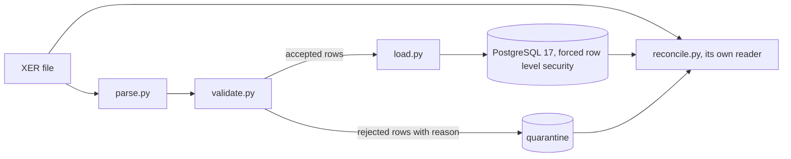

# xerlane

Loads Primavera XER schedules, cost exports and model data into PostgreSQL per client, quarantines bad rows, proves the data equals the file and shows earned value per client.

[](https://github.com/Exalt24/xerlane/actions/workflows/ci.yml)


*A real run on an invented schedule (transcript: [docs/demo-transcript.txt](docs/demo-transcript.txt)). Load, reconcile passing, three planted defects set aside with their reasons, then one cent of damage in the database found by reconcile.*

**925 tests. Every mutant killed in eight modules (1,757 in all). 41 more tests on the web app. A 6 MB file of 65,686 rows loaded in 3.1 s.** Measured 2026-11-07, numbers and commands below.

## What it is and why

A schedule export is one text file holding dozens of linked tables. Loading it into a database well means not trusting the file and not trusting the loader. A predecessor can point at a task that is not there. Two relationships can chase each other in a loop. A row can lose a field. A loader that quietly skips such rows reports a clean load of a wrong schedule.

xerlane reads an XER file with a streaming parser that names every line it does not understand. It validates the file and loads what passes into typed PostgreSQL tables with real keys. Every row that fails goes into a quarantine table with the reason and the original fields. A separate reader then re-reads the file and the database and checks that nothing went missing or changed. Each client's rows are fenced off with forced row level security.

The table and column names come from Oracle's published XER data map. The file syntax comes from open source readers, because no Oracle page I could load describes it. Both are quoted, dated and linked in [docs/vendor-contract/SOURCE.md](docs/vendor-contract/SOURCE.md), and what no page settles is listed in [docs/NOT_CONFIRMED.md](docs/NOT_CONFIRMED.md).

## What it does

| Part | What it does | Where |
|---|---|---|
| Parse | Streams the file line by line. Typed rows for seven tables (CALENDAR, RSRC, PROJECT, PROJWBS, TASK, TASKPRED, TASKRSRC), raw rows for the rest. A wrong field count, a bad number or date, an unknown marker, a stray line, a missing `%E` each become a named problem with its line number. | `xerlane/parse.py` |
| Validate | Before the load and again on the stored data: references exist, no dependency cycle (one path reported per cycle), start not after finish, calendar exists, no duplicate task code, no orphan assignment, numbers in range, relationship type one of four. | `xerlane/validate.py` |
| Load | One transaction per project. Reloading the same file changes nothing. A newer version updates the project and writes a change report: tasks added, removed, finish moved, float changed. A failed load leaves nothing behind. | `xerlane/load.py` |
| Quarantine | A row that fails a rule is stored in `quarantine` with its rule code, reason, line number and raw fields. The tasks, links and assignments that depended on it follow it in. | `quarantine` table |
| Tenants | A `tenant_id` is part of every key and every table has forced row level security: no tenant setting means no rows. | `xerlane/schema.sql` |
| Reconcile | Reads the file with its own small reader and the database with its own queries. Per table: file rows equal stored plus quarantined, every numeric column adds up to the same total, a seeded sample of rows matches field by field. Any difference is a named finding and exit code 1. | `xerlane/reconcile.py` |
| Rust tokenizer | A second reader of the file structure in Rust, checked against the Python parser. It is not a loader. | `rust/xer-tokenizer/`, [docs/rust-tokenizer.md](docs/rust-tokenizer.md) |



**Autodesk Platform Services.** `python -m xerlane.aps sync` loads a translated model's object properties into the same schema. It keeps a change log and a quarantine, applies row level security and joins to the XER tasks by task code. Written from Autodesk's documentation and tested against a stand-in server that follows it. See [docs/aps.md](docs/aps.md).

**Cost and commitment exports.** `python -m xerlane load-cost FILE --kind cost|commitment --tenant T` loads a CSV export with the same row by row quarantine, no-op reload and reconcile. The report command (`python -m xerlane report`) joins budget and actual cost to schedule progress as earned value (PV, EV, AC, CPI, SPI, EAC). It reports by task, by cost code and by model element, as text, CSV or one HTML page. See [docs/cost.md](docs/cost.md).

**Web app.** `web/` is a Nuxt and TypeScript app. A client's staff sign in and see only their own projects, earned value and set aside rows. Administrators add and disable users. The separation between clients is the database's forced row level security, not a filter in the code. See [docs/web.md](docs/web.md).


## Run it

You need Python 3.13 and Docker (PostgreSQL 17 runs in a container on port 5435). No accounts, keys or downloads.

```
python -m venv .venv
.venv/Scripts/activate        # Windows; on Linux and macOS: source .venv/bin/activate
pip install -r requirements.txt
```

Then three commands:

```
python tools/pg.py up && python -m xerlane init-db
python tools/make_sample_xer.py --seed 7 --tasks 400 --out out/plan.xer
python -m xerlane load out/plan.xer --tenant acme && python -m xerlane reconcile out/plan.xer --tenant acme
```

The last one prints (measured 2026-11-06):

```
project    XL-01 (1010)  LOADED  wbs 27 tasks 400 links 687 assigns 219  quarantined 0
result     LOADED in 0.30 s
...
result     RECONCILED: counts, sums and sampled rows match the file
```

Plant defects with `--defect cycle --defect bad_number` (`--list-defects` shows all 15) and load the file again to see them set aside.

Every command, its arguments and its exit codes are in [docs/commands.md](docs/commands.md). The commands are `init-db`, `load`, `validate`, `reconcile`, `diff`, `load-cost`, `reconcile-cost`, `report` and `add-user`. The loader refuses to run as a superuser or any role that bypasses row level security, because that role would see every tenant.

## Measured results

All numbers are from my runs on 2026-11-06 (Windows 11, Python 3.13, PostgreSQL 17 in Docker on the same machine).

| What | Result | How |
|---|---|---|
| Tests | 925 passing in Python (the XER side, the Autodesk connector, the cost loader, the earned value report, users and the command line, Hypothesis property tests among them) and 41 for the web app | `python -m pytest`, and `cd web && npm run build && npm test` |
| Mutants | 1,345 derived from the syntax tree of seven modules, 1,345 killed, 0 survived | `python tests/mutation_check.py --module parse` (and validate, load, reconcile, db, cost, evm); per module totals in [docs/mutation-results.txt](docs/mutation-results.txt) |
| Mutants, APS connector | 412 derived from the syntax tree of `xerlane/aps.py`, 412 killed, 0 survived; run by hand, not in CI | `python tests/mutation_check_aps.py` |
| Load, 6.1 MB | 65,686 rows (20,000 tasks, 34,965 links, 10,677 assignments) in 3.1 s (three runs: 3.0, 3.1, 3.3); reloading the same file 1.6 s | `python tools/make_sample_xer.py --seed 11 --tasks 20000` then `load` |
| Parse alone, same file | 0.7 s | `parse_file` |
| Rust tokenizer, same 6 MB file | Same output as the Python parser on 461 files, red on two planted breakages; 37 ms fastest of 21 runs, where `parse_file` takes 629 ms and also hashes and types the fields | `python tools/xer_conformance.py`, `python tools/xer_bench.py` ([output](docs/rust-tokenizer-run.txt)) |
| Reconcile, same file | 0.4 s | `reconcile` |

## What was hard

- **A control for the checker.** A reconcile that says "match" proves nothing until it has been seen to say "differ". [tests/test_reconcile.py](tests/test_reconcile.py) damages the stored data on purpose (one row, one cent, one character, one minute, one hour of float, a quarantined row, 17 kinds). It requires reconcile to fail each time with the right check name, after first requiring it to pass.
- **Isolation that can fail.** [tests/test_tenant.py](tests/test_tenant.py) first shows a tenant reading its own rows. Then it shows another tenant, and a connection with no tenant at all, reading none. A second test turns `FORCE` off and shows the table owner then reads everything, so the test above it can fail.
- **The first mutation pass found lines no test pinned.** Of 848 mutants of the parser, rules, loader and reconcile, 90 survived. An id of 9223372036854775808 passed the digit check. Two rules that both fire on one row were not shown to report only the first. A reload of a file that differs only in its header date was not shown to move the quarantine rows to the new file hash. The reported load time was never checked to be a time. Tests were added for each survivor and a few redundant lines were deleted. None of the mutants was removed.
- Three more: [docs/more-hard-parts.md](docs/more-hard-parts.md).

## Tests

```
python tools/pg.py up        # the tests need the container; a missing database fails them, it never skips them
python -m pytest             # 925 tests
python tests/mutation_check.py --module parse    # one module at a time; --summary totals them
```

Connector: `python -m pytest tests/test_aps_*.py; python tests/mutation_check_aps.py` (the mutation check is run by hand, not in CI). Web app: `cd web && npm run build && npm test && npm run typecheck`, run by CI in its own job. Query plans: [docs/query-tuning.md](docs/query-tuning.md).

What the suites cover, the Hypothesis properties and how the mutation check flips guards are in [docs/tests.md](docs/tests.md). The mutation check requires a failing test for every change it makes.

CI runs the same suite against a PostgreSQL 17 service container, plus a `rust` job (fmt, clippy, test, conformance).

## Limits

- The test schedules come from `tools/make_sample_xer.py`, which writes the files from the XER layout and the Oracle table and column names, with planted defects. The parts Oracle does not publish are listed in this repo.
- The file syntax comes from two open source readers and a National Archives registry entry. It covers the header line, `%T`, `%F`, `%R`, `%E`, tab delimited, cp1252 and date shapes. Oracle's pages name the tables and columns but not the syntax. Column types are inferred from column names. [docs/NOT_CONFIRMED.md](docs/NOT_CONFIRMED.md) lists 15 things no loaded page settles and what the code does about each.
- The Rust crate re-reads the file structure only, from the same notes on the layout as the Python parser. A misreading they share goes unseen. It is not a loader.
- Seven tables are modeled. About 60 others in the data map are read, counted, reported as `UNMODELED_TABLE` and not loaded.
- The cost and commitment layouts are my own (docs/cost.md says why). No vendor's export was read. Percent complete and planned value use the simplest methods (duration based, straight line on the calendar). The Autodesk connector reads object properties of a translated model and nothing else. It has only talked to a stand-in server I wrote from Autodesk's documentation, never to Autodesk.
- A relationship between two projects is quarantined by name, not loaded. A project is identified by (tenant, `proj_id`).
- Dates are stored without a time zone, hours as plain numbers, nothing converted.
- The command line takes whatever tenant id the caller passes to `--tenant`. Row level security keeps tenants apart. Which person may use which tenant id is decided by the web app's login (docs/web.md) and nowhere else. The web app has run on generated data on one machine, without TLS, a password reset or two factor sign in.
- Reconcile checks every count and every sum. It also checks a seeded sample of 300 rows per table field by field (`--sample` changes it).

## Stack

Python 3.13, PostgreSQL 17, psycopg 3, pytest, Hypothesis and Docker. A small Rust crate does the file tokenizer. The web app adds TypeScript, Nuxt (Vue), Nitro, pg and Vitest.

## License

MIT, see [LICENSE](LICENSE).
