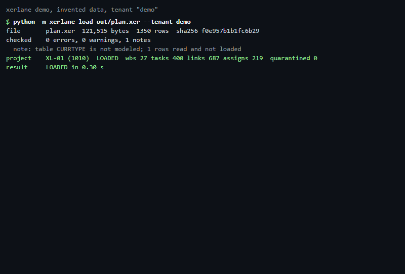
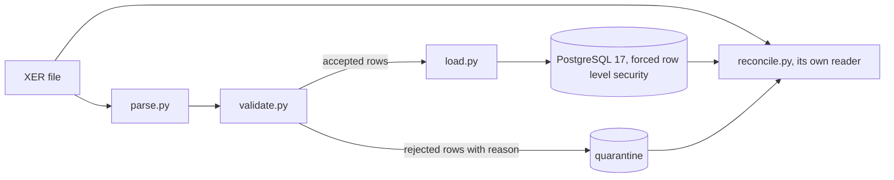

# xerlane

Load Primavera XER schedules into PostgreSQL per client, set aside the rows that fail validation, and prove the data equals the file.

[](https://github.com/Exalt24/xerlane/actions/workflows/ci.yml)



*A real run on an invented schedule (transcript: [docs/demo-transcript.txt](docs/demo-transcript.txt)). Load, reconcile passing, three planted defects set aside with their reasons, then one cent of damage in the database found by reconcile.*

**788 tests, 878 of 878 mutants killed on the XER side and 412 of 412 on the APS side, a 6 MB file of 65,686 rows loaded in 3.1 s** (measured 2026-11-06, numbers and commands below).

## What it is and why

A schedule export is one text file holding dozens of linked tables. Loading it into a database well means not trusting the file and not trusting the loader: a predecessor can point at a task that is not there, two relationships can chase each other in a loop, a row can lose a field, and a loader that quietly skips such rows reports a clean load of a wrong schedule.

xerlane reads an XER file with a streaming parser that names every line it does not understand, validates it, loads what passes into typed PostgreSQL tables with real keys, and writes every row that fails into a quarantine table with the reason and the original fields. A separate reader then re-reads the file and the database and checks that nothing went missing or changed. Each client's rows are fenced off with forced row level security.

The table and column names come from Oracle's published XER data map. The file syntax comes from open source readers, because no Oracle page I could load describes it. Both are quoted, dated and linked in [docs/vendor-contract/SOURCE.md](docs/vendor-contract/SOURCE.md), and what no page settles is listed in [docs/NOT_CONFIRMED.md](docs/NOT_CONFIRMED.md).

## What it does

| Part | What it does | Where |
|---|---|---|
| Parse | Streams the file line by line. Typed rows for seven tables (CALENDAR, RSRC, PROJECT, PROJWBS, TASK, TASKPRED, TASKRSRC), raw rows for the rest. A wrong field count, a bad number or date, an unknown marker, a stray line, a missing `%E` each become a named problem with its line number. | `xerlane/parse.py` |
| Validate | Before the load and again on the stored data: references exist, no dependency cycle (one path reported per cycle), start not after finish, calendar exists, no duplicate task code, no orphan assignment, numbers in range, relationship type one of four. | `xerlane/validate.py` |
| Load | One transaction per project. Reloading the same file changes nothing. A newer version updates the project and writes a change report: tasks added, removed, finish moved, float changed. A failed load leaves nothing behind. | `xerlane/load.py` |
| Quarantine | A row that fails a rule is stored in `quarantine` with its rule code, reason, line number and raw fields. The tasks, links and assignments that depended on it follow it in. | `quarantine` table |
| Tenants | A `tenant_id` is part of every key and every table has forced row level security: no tenant setting means no rows. | `xerlane/schema.sql` |
| Reconcile | Reads the file with its own small reader and the database with its own queries. Per table: file rows equal stored plus quarantined, every numeric column adds up to the same total, a seeded sample of rows matches field by field. Any difference is a named finding and exit code 1. | `xerlane/reconcile.py` |



**Autodesk Platform Services.** `python -m xerlane.aps sync` loads a translated model's object properties into the same schema, with a change log, a quarantine, row level security and a task code join to the XER tasks. Written from Autodesk's documentation and tested against a stand-in server, never run against a live account. See [docs/aps.md](docs/aps.md).

## Run it

You need Python 3.13 and Docker (PostgreSQL 17 runs in a container on port 5435). No accounts, keys or downloads.

```
python -m venv .venv
.venv/Scripts/activate        # Windows; on Linux and macOS: source .venv/bin/activate
pip install -r requirements.txt
```

Then three commands:

```
python tools/pg.py up && python -m xerlane init-db
python tools/make_sample_xer.py --seed 7 --tasks 400 --out out/plan.xer
python -m xerlane load out/plan.xer --tenant acme && python -m xerlane reconcile out/plan.xer --tenant acme
```

The last one prints (measured 2026-11-06):

```
project    XL-01 (1010)  LOADED  wbs 27 tasks 400 links 687 assigns 219  quarantined 0
result     LOADED in 0.30 s
...
result     RECONCILED: counts, sums and sampled rows match the file
```

Plant defects with `--defect cycle --defect bad_number` (`--list-defects` shows all 15) and load the file again to see them set aside.

| Command | What it does | Exit code |
|---|---|---|
| `init-db` | Creates the two roles, the schema and the tables. Safe to run twice. | 0 |
| `load FILE --tenant T` | Parse, validate, load. | 0 clean, 1 loaded with quarantined rows, 2 file rejected or a project failed |
| `validate FILE [--tenant T]` | Check the file; with a tenant also the stored data of its projects. | 0 clean, 1 errors found |
| `reconcile FILE --tenant T` | Prove the stored data equals the file. | 0 matches, 1 differences |
| `diff FILE --tenant T` | What loading the file would change, without writing. | 0 nothing, 1 changes |

The loader refuses to run as a superuser or any role that bypasses row level security, because that role would see every tenant.

## Measured results

All numbers are from my runs on 2026-11-06 (Windows 11, Python 3.13, PostgreSQL 17 in Docker on the same machine).

| What | Result | How |
|---|---|---|
| Tests | 788 passing: 558 for the XER side (7 of them Hypothesis property tests, 720 generated examples) and 230 for the APS connector | `python -m pytest` |
| Mutants | 878 derived from the syntax tree of five modules, 878 killed, 0 survived | `python tests/mutation_check.py --module parse` (and validate, load, reconcile, db); per module totals in [docs/mutation-results.txt](docs/mutation-results.txt) |
| Mutants, APS connector | 412 derived from the syntax tree of `xerlane/aps.py`, 412 killed, 0 survived; run by hand, not in CI | `python tests/mutation_check_aps.py` |
| Load, 6.1 MB | 65,686 rows (20,000 tasks, 34,965 links, 10,677 assignments) in 3.1 s (three runs: 3.0, 3.1, 3.3); reloading the same file 1.6 s | `python tools/make_sample_xer.py --seed 11 --tasks 20000` then `load` |
| Parse alone, same file | 0.7 s | `parse_file` |
| Reconcile, same file | 0.4 s | `reconcile` |

## What was hard

- **A control for the checker.** A reconcile that says "match" proves nothing until it has been seen to say "differ". [tests/test_reconcile.py](tests/test_reconcile.py) damages the stored data on purpose (one row, one cent, one character, one minute, one hour of float, a quarantined row, 17 kinds) and requires reconcile to fail each time with the right check name, after first requiring it to pass.
- **Isolation that can fail.** [tests/test_tenant.py](tests/test_tenant.py) first shows a tenant reading its own rows, then shows another tenant, and a connection with no tenant at all, reading none. A second test turns `FORCE` off and shows the table owner then reads everything, so the test above it can fail.
- **Swapping two task codes between versions.** The unique key on (tenant, project, task code) rejected an update that swapped two codes, though the end state was valid. The key is now deferred to commit; [test_swapping_two_task_codes_between_versions_does_not_trip_the_unique_key](tests/test_load.py) pins it.
- **The first mutation pass found lines no test pinned.** Of 848 mutants of the parser, rules, loader and reconcile, 90 survived: an id of 9223372036854775808 passed the digit check, two rules that both fire on one row were not shown to report only the first, a reload of a file that differs only in its header date was not shown to move the quarantine rows to the new file hash, the reported load time was never checked to be a time. Tests were added for each survivor and a few redundant lines were deleted; none of the mutants was removed.
- **`init-db` raced itself.** The mutation check runs several workers, each with its own database, and two `init-db` calls at once failed on creating the roles and the schema. It now takes an advisory lock and treats an existing role as done; [test_init_db_run_by_several_processes_at_once_does_not_fail](tests/test_db.py) runs six at once on a fresh server state.
- **A connection to a closed port hung past two minutes on Windows.** `connect_timeout=10` now bounds it; [test_tenant_is_required_and_the_database_must_be_reachable](tests/test_cli.py) pins it.

## Tests

```
python tools/pg.py up        # the tests need the container; a missing database fails them, it never skips them
python -m pytest             # 788 tests, TIME s in a fresh clone
python tests/mutation_check.py --module parse    # one module at a time; --summary totals them
```

Connector: `python -m pytest tests/test_aps_*.py; python tests/mutation_check_aps.py` (the mutation check is run by hand, not in CI).

What they cover: the parser (every problem code, both line endings, encodings, typed values accepted and refused), the rules (hand built schedules and every planted defect kind, generated), the loader on a real PostgreSQL (idempotence, change report, rollback, quarantine, several projects), tenants, reconcile and its damage control, the command line as a real process, and the generator.

Hypothesis properties, run on random schedules with random damage to the file: the parser never raises and a rendered file parses back to exactly the rendered rows; every row of the file is stored or quarantined and reconcile agrees; loading the same file twice changes nothing; loading version 1 then version 2 leaves the same project data as loading version 2 alone; a planted defect is always reported under its code and a file-level defect always rejects the file and writes nothing; two tenants with identical ids, including ids made of quotes and percent signs, never see each other.

The mutation check ([tests/mutation_check.py](tests/mutation_check.py)) flips or removes one guard at a time in a copy of the code (comparisons, `and` and `or`, a removed `not`, a negated condition, an `if` that ends in `raise` or `return` replaced by `pass`, a dropped call, a returned value turned into `None`, the rule codes emptied) and requires a failing test for each.

CI runs the same suite against a PostgreSQL 17 service container.

## Limits

- Everything xerlane has read was invented. `tools/make_sample_xer.py` writes the files from the layout and the Oracle table and column names; xerlane has not read a real Primavera export or any client's system, and it is not production software.
- The file syntax (header line, `%T`, `%F`, `%R`, `%E`, tab delimited, cp1252, date shapes) is taken from two open source readers and a National Archives registry entry. Oracle's pages name the tables and columns but not the syntax. Column types are inferred from column names. [docs/NOT_CONFIRMED.md](docs/NOT_CONFIRMED.md) lists 15 things no loaded page settles and what the code does about each.
- Seven tables are modeled. About 60 others in the data map are read, counted, reported as `UNMODELED_TABLE` and not loaded.
- The schedule loader reads XER only; cost and commitment exports are not loaded. The Autodesk connector reads object properties of a translated model and nothing else, and it has only talked to a stand-in server I wrote from Autodesk's documentation, never to Autodesk.
- A relationship between two projects is quarantined by name, not loaded. A project is identified by (tenant, `proj_id`).
- Dates are stored without a time zone, hours as plain numbers, nothing converted.
- There is no web app and no login. The tenant id is whatever the caller passes to `--tenant`; row level security keeps tenants apart, deciding who may use which tenant id is outside this code.
- Reconcile checks every count and every sum, and a seeded sample of 300 rows per table field by field (`--sample` changes it).

## Stack

Python 3.13, PostgreSQL 17, psycopg 3, pytest, Hypothesis, Docker.

## License

MIT, see [LICENSE](LICENSE).
