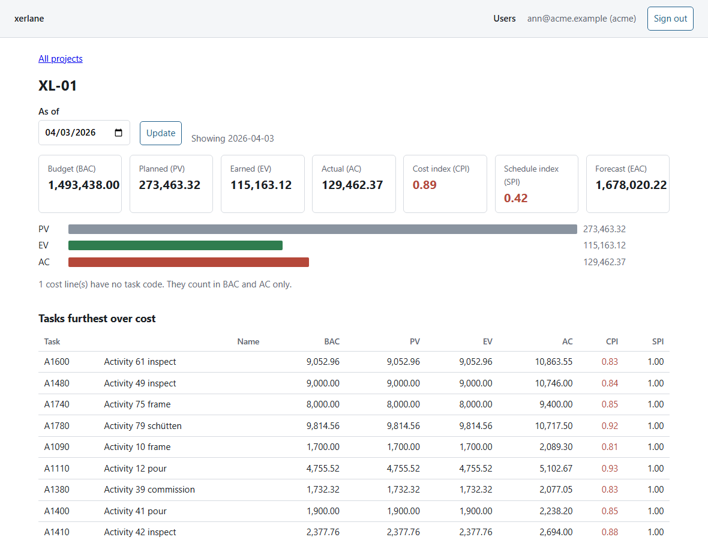

# The web app

`web/` is a small client facing app on the same database: staff of one client sign in and see only that client's projects, earned value and rows that were set aside. It is a Nuxt (Vue) single page app in TypeScript in front of a Nitro API, with `pg` as the only database dependency.



## Run it

```
python tools/pg.py up && python -m xerlane init-db
XERLANE_NEW_PASSWORD='a long passphrase here' python -m xerlane add-user --tenant acme --email ann@acme.example --role admin
cd web && npm install && npm run build && node .output/server/index.mjs
```

The server reads `XERLANE_APP_PASSWORD` (and optionally `XERLANE_PG_HOST`, `XERLANE_PG_PORT`, `XERLANE_PG_DB`, or a whole `XERLANE_DSN`) from the environment or from the `.env` that `tools/pg.py` writes. Pages: sign in, projects, one project (an as-of date moves the planned value), and an administrator page to add and disable users.

## How the separation between clients works

- **The tenant never comes from a request.** A signed in request carries only a session cookie. The server finds the session row, takes the tenant from it, and runs every query inside one transaction that sets `app.tenant_id` for that transaction. PostgreSQL's forced row level security does the rest, so a query that forgets a `WHERE` still returns one client's rows. A project id from another client answers 404, the same as an id that does not exist.
- **The database role cannot bypass it.** The server connects as `xerlane_app` and refuses to run if its role is a superuser or has `BYPASSRLS` (a test connects as the superuser and requires the refusal).
- **Login reads before it knows the tenant,** so `app_user`, `app_session` and `login_attempt` each have exactly one extra door: a setting naming the email being tried or the hash of the cookie being checked. Nothing can be written through those doors; writes still need the tenant setting (`tests/test_users.py` tries each).
- **Passwords** are scrypt hashes (`scrypt$N$r$p$salt$hash`), the same format from Python (`add-user`) and Node (the administrator page); both sides verify each other's hashes in the tests. A cut-off hash is refused, because a shorter scrypt output is a prefix of the full one and would accept a short guess.
- **Sessions** are a random 32 byte token in an httpOnly, same-site cookie (secure when the request is https) that lasts eight hours; the database keeps only the token's SHA-256. Signing out deletes the row, so the old cookie is dead on the server. Disabling a user deletes their sessions.
- **Login attempts** are counted per email: five failures in fifteen minutes answer 429 even for the right password. An unknown email and a wrong password get the same answer and cost the same time (a dummy hash is checked).
- **State changing requests** must be JSON, must not name another origin, and must not say `Sec-Fetch-Site: cross-site`.
- **Roles:** a viewer reads; an administrator also lists, adds and disables users of their own client. Every route checks on the server; the page middleware only keeps people from clicking into a page that would refuse them.

## Tests

```
cd web && npm run build && npm test     # vitest, 41 tests, against PostgreSQL from tools/pg.py in a database of its own
npm run typecheck
```

The API tests start the built server as a real process and drive it with `fetch`: unauthenticated requests, the cookie flags, wrong password against unknown email, the lock, sign out and expiry, two clients side by side (lists, report, quarantine, the other client's ids), the administrator routes (including a client's administrator trying to disable another client's user), cross-origin and non-JSON requests, and the headers. `test/ev.test.ts` checks the report SQL against the hand worked schedule from `tests/test_evm.py`. Thirteen deliberate breakages (an admin check removed, the lock raised to 500, sessions that never expire, a hard coded tenant, a finished task that earns nothing, and so on) each turned the run red; the two that first went unseen got their own tests.

## Limits

- It has been run on invented data only, on one machine, behind no proxy and no TLS. The cookie is marked secure when the request arrives as https or `X-Forwarded-Proto: https`.
- The Content-Security-Policy keeps `script-src 'unsafe-inline'` because the page shell Nuxt writes holds one inline script.
- An email is unique across all clients (a login starts from it), so adding an address that another client already uses is refused with the same message as a duplicate in the same client.
- No password reset, no email, no two factor, no per-IP limit on top of the per-email one. A real deployment would put those in front.
- The report shows no model viewer; the model elements are joined in `python -m xerlane report`, not drawn in the page.
